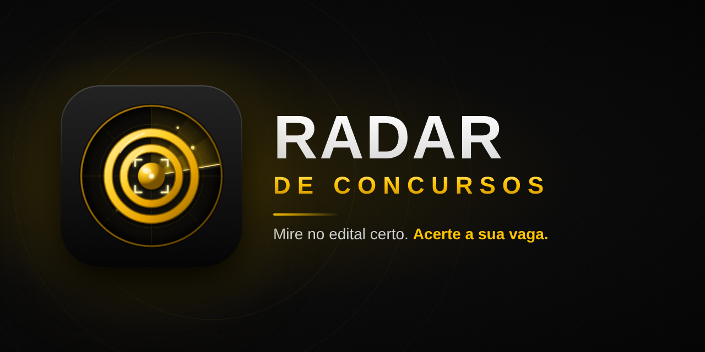
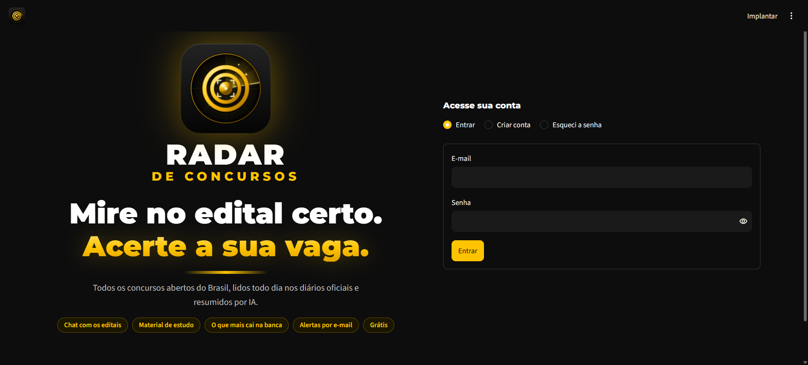
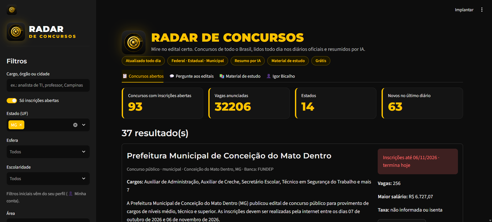
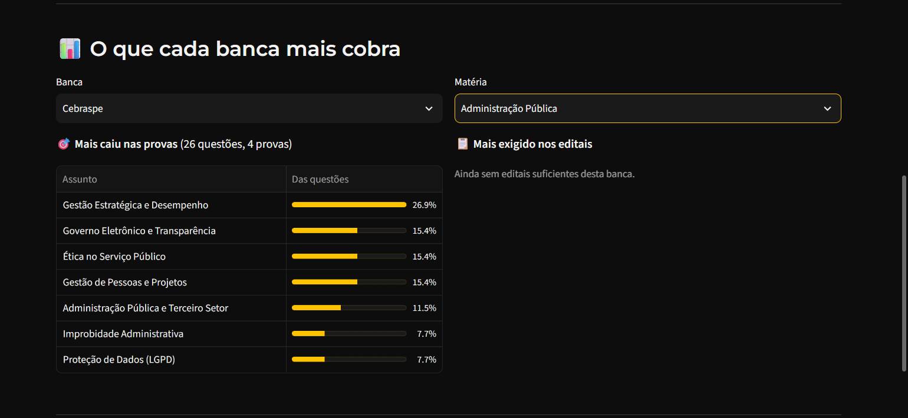
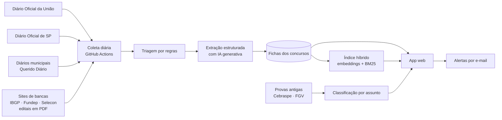

  

<h3 align="center">Mire no edital certo. Acerte a sua vaga.</h3>

  <a href="https://radar-concursos.streamlit.app"><b>🔗 Acessar o app</b></a> ·
  Produto em desenvolvimento · Código-fonte privado

---

## O que é

O **Radar de Concursos** lê todos os dias, de forma automática, os diários oficiais e os sites das bancas organizadoras e mostra, num só lugar, os **concursos e processos seletivos com inscrições abertas no Brasil** (federais, estaduais e municipais), já resumidos por inteligência artificial.

Além da lista, o concurseiro conversa com os editais, recebe alertas do seu perfil por e-mail, estuda com material gerado a partir do conteúdo programático e descobre **o que mais cai em cada banca**.

  

## Funcionalidades

| | |
|---|---|
| 📋 **Concursos abertos** | Lista atualizada todo dia, com filtros por estado, esfera, escolaridade, área e salário. Ficha com cargos, vagas, salários, taxa, banca e prazo. |
| 💬 **Pergunte aos editais** | Chat com IA (RAG) que responde em linguagem natural e cita a fonte: *"tem vaga de TI em MG?"*, *"quais são de nível médio?"* |
| 📚 **Material de estudo** | A partir do conteúdo programático do edital: resumo da matéria e questões **originais** no estilo da banca, com gabarito comentado e conferência por uma segunda IA. |
| 🎯 **O que mais cai** | Assuntos mais cobrados por banca, a partir de quase 3 mil questões de provas da Cebraspe e da FGV classificadas por IA, e dos editais de cada banca. |
| 🔔 **Alertas por e-mail** | Um e-mail por dia, só com os concursos novos do perfil do usuário. |
| 👤 **Conta do usuário** | Login com e-mail e senha, confirmação por código, perfil salvo que já filtra a lista e exclusão de conta (LGPD). |

  

  

## Como funciona

1. **Coleta diária automática** (GitHub Actions, de segunda a sábado): DOU, Diário Oficial de SP, diários municipais (Querido Diário) e sites de bancas, incluindo o texto dos editais e anexos em PDF.
2. **Triagem por regras**: descarta resultados, convocações, homologações e retificações antes de gastar IA.
3. **Extração estruturada com IA generativa** (Gemini, saída em JSON com schema): órgão, cargos, escolaridade, vagas, salários, taxa, banca e prazos, com cálculo de prazos relativos e validação.
4. **RAG com busca híbrida**: embeddings + BM25 combinados por Reciprocal Rank Fusion, e um roteador que identifica se a pergunta pede uma lista de concursos ou um detalhe de um edital.
5. **Material de estudo verificado**: questões criadas pela IA são resolvidas por uma segunda IA sem ver o gabarito; só ficam as que batem e não têm defeito apontado.
6. **O que mais cai**: provas públicas das bancas são classificadas por assunto. Guardamos só a contagem, nunca o texto das questões.
7. **Coleta responsável**: respeito ao robots.txt, robô identificado e pausas entre acessos.

## Tecnologias

`Python` · `Google Gemini` (extração, RAG, geração e verificação) · `Embeddings` + `BM25` (rank-bm25) · `Streamlit` · `Supabase` (Auth e Postgres) · `GitHub Actions` · `pandas` · `NumPy` · `pypdf` · `Gmail SMTP`

## Números

- Fontes lidas todos os dias: **4 tipos** (DOU, DOE-SP, diários municipais e bancas)
- Concursos abertos acompanhados: **cerca de 90**, em **14 estados**
- Questões de provas classificadas por assunto: **quase 3 mil**

## Sobre o código

O código-fonte é **privado**, porque o Radar está se tornando um produto. Para recrutadores e parceiros, apresento a arquitetura e o código em uma conversa. É só entrar em contato.

---

Feito por <b>Igor Bicalho</b> · <a href="https://github.com/igorbicalho88">github.com/igorbicalho88</a>

